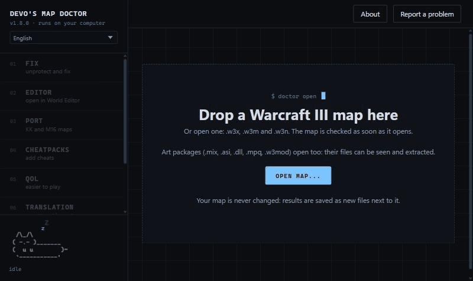

<div align="center">


# Devo's Map Doctor

Open, fix and port Warcraft III maps for Reforged.

[](https://github.com/devoltzz/devos-map-doctor/releases/latest)
[](https://github.com/devoltzz/devos-map-doctor/releases)
[](LICENSE)
[](#get-it)

**[Download](https://github.com/devoltzz/devos-map-doctor/releases/latest)** ·
**[Use it in the browser](https://doctor.devoltz.party)** ·
**[Report a problem](https://github.com/devoltzz/devos-map-doctor/issues/new)**



</div>

The Doctor opens protected Warcraft III maps, fixes what stops them on Reforged 3.0 (or on an older game), prepares
them for the World Editor, ports the maps of the Chinese KK and Korean M16 platforms, translates maps and finds out why
a map fails in the game. The map you open is never changed: every result is a new file next to it.

## Get it

**In the browser:** [doctor.devoltz.party](https://doctor.devoltz.party). Nothing to install, and your map never leaves
your computer. Chrome, Edge or Firefox on a computer, maps up to 450 MB.

**Windows:**

1. Download `DevosMapDoctor.exe` and `names.npz` from [Releases](https://github.com/devoltzz/devos-map-doctor/releases/latest).
2. Keep them in the same folder.
3. Open `DevosMapDoctor.exe` and drop a map on the window.

**Linux** (x86-64, glibc 2.35 or newer: Ubuntu 22.04+, Debian 12+, Fedora 36+, Mint 21+):

1. Download `DevosMapDoctor-linux-x86_64` and `names.npz` into the same folder.
2. `chmod +x DevosMapDoctor-linux-x86_64`
3. Run it. The window uses the system's WebKitGTK: `sudo apt install gir1.2-webkit2-4.1` (Debian, Ubuntu) or
   `sudo dnf install webkit2gtk4.1` (Fedora). To port maps, point `WC3_GAME` at the Warcraft III folder (under Wine
   or Lutris).

The program tells you when a new version is out. The window is in English and 16 other languages.

## Use it

Open a map. The Doctor reads it at once and says what it needs, then one button does the job:

| Action | What it does |
|---|---|
| **Fix map** | Removes the protection and repairs what stops the map on Reforged 3.0. |
| **Open in World Editor** | Writes a copy the World Editor opens, with the GUI triggers rebuilt when the round trip proves them. |
| **Port** | Ports KK, KKWE, YDWE and M16 maps to Reforged (their platform natives implemented, their scripts back in JASS or Lua), and a classic map to a newer classic game. |
| **Diagnose** | Finds out why a map fails in the game: a diagnostic copy that logs while you play, and the readers of the game's crash report, log and replays. |

The tabs show the rest: the map card, "Runs on Reforged?", the files and the script, the triggers, the translation,
the comparison of two versions, cheat packs and quality of life edits. How to translate a map:
[README-translation.md](README-translation.md).

**Command line:** the same jobs from a terminal (`doctor.exe` appears next to the program the first time you open it;
on Linux the program itself takes the commands):

```
doctor fix map.w3x
doctor --help
```

## Questions

**The ported map needs the art of the platform.** In Port, add the art packages the map needs (`.mix`,
`.asi`, `.dll`, `.mpq`, `.w3mod`) or a folder of loose files ("Add a folder..."). Files from a folder stay out of the
map and are written next to it, with a README on how to use them with "Allow Local Files".

**The game does not list my map.** Warcraft III does not list maps above 512 MiB. "Make the map smaller, losing
nothing" (in Fix map) recompresses every file and stores copies once; if the map is still too big, "If still above 512
MiB, make the art smaller" halves the biggest textures and makes WAV sounds mono.

**I want to edit the map in the classic World Editor.** In Open in World Editor, choose the editor of the map's own
version (1.24 to 1.29) instead of Reforged: the copy keeps that version. The files of the old editors are downloaded
once, when you choose one.

**The game closes on my map.** Use Diagnose: make a diagnostic copy, play it until the problem happens, then read its
log. It says what the map started and never finished. The game's own crash report and the replay are read there too.

**The Doctor says "Not allowed to edit".** The author of that map marked it as not allowed to edit, and the Doctor
respects that: it shows what the map is, its card and whether it runs, but it does not unprotect, fix, port, translate
or extract it. Ask the author for the map you need.

**Is my map sent anywhere?** No. Everything runs on your computer (or inside the page, on the site). The program only
asks GitHub whether a new version is out, and downloads what you accept (the translation models, the old editors).

## Changes

What each version brought: [CHANGELOG.md](CHANGELOG.md).

## Building

`pip install -r requirements.txt`, then `python build.py` writes `dist/DevosMapDoctor.exe` (with Rust installed,
`cargo` also builds the script checks of `native/jass_checks`). `python build_linux.py` writes
`dist/DevosMapDoctor-linux-x86_64` in a Docker container. The site is built by `web/build_site.py`.

## Thanks

[caiohsr14](https://github.com/caiohsr14), sangje_wc3 ([hachamacha106](https://github.com/hachamacha106)),
[Unryze](https://github.com/UnryzeC), [garden-hose](https://github.com/garden-hose) and everyone who reported a map.
The projects whose code, data or measurements the Doctor uses are credited in
[THIRD_PARTY_NOTICES.md](THIRD_PARTY_NOTICES.md).

## License

MIT, see [LICENSE](LICENSE).
