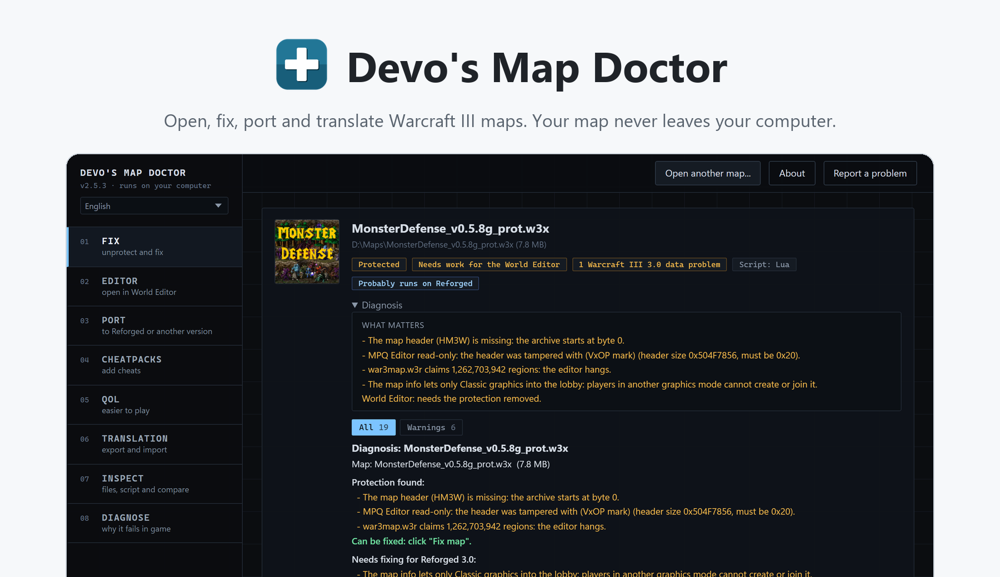

<picture>
  <source media="(prefers-color-scheme: dark)" srcset="docs/images/banner-dark.png">
  
</picture>

**[Download](https://github.com/devoltzz/devos-map-doctor/releases/latest)** ·
**[Use it in the browser](https://doctor.devoltz.party)** ·
**[Report a problem](https://github.com/devoltzz/devos-map-doctor/issues/new)**

## Get it

| | |
|---|---|
| **Browser** | [doctor.devoltz.party](https://doctor.devoltz.party): nothing to install, maps up to 450 MB. |
| **Windows** | `DevosMapDoctor.exe` and `names.npz` from [Releases](https://github.com/devoltzz/devos-map-doctor/releases/latest), in the same folder. |
| **Linux** | `DevosMapDoctor-linux-x86_64` and `names.npz`, then `chmod +x`. Needs WebKitGTK (`gir1.2-webkit2-4.1` or `webkit2gtk4.1`). |

## Use it

1. Open a map (`.w3x`, `.w3m`, `.w3n`).
2. Read the diagnosis.
3. Click **Fix map**, **Open in World Editor**, **Port** (KK, YDWE, M16 to Reforged) or **Diagnose**.

Your map is never changed: every result is a new file next to it. Translate a map:
[README-translation.md](README-translation.md). Command line: `doctor --help`.

## License

MIT, see [LICENSE](LICENSE). Third-party credits: [THIRD_PARTY_NOTICES.md](THIRD_PARTY_NOTICES.md).
